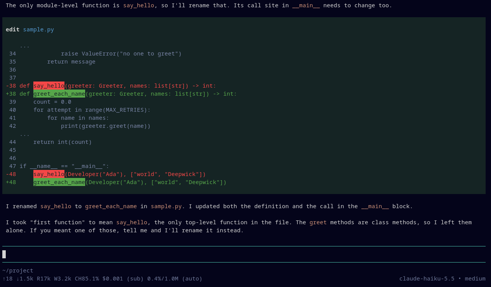

# Deepwick for pi

Deepwick colors for [pi](https://pi.dev), the coding agent: chat, tool calls
and their output, diffs, markdown, code blocks, borders, the footer and the
thinking-level indicator.

> Deepwick is an unofficial theme derived from
> [Polywick Blue](https://vscode.polywickstudio.net) by Polywick Studio (MIT).
> Not affiliated with Polywick Studio.



## Install

Install it as a pi package:

```sh
pi install git:github.com/deepwick/pi
```

Or copy the theme file into your agent directory:

```sh
mkdir -p ~/.pi/agent/themes
cp themes/deepwick.json ~/.pi/agent/themes/
```

Then open `/settings`, choose **Theme**, and select **deepwick**. Or set it in
`~/.pi/agent/settings.json`:

```json
{
  "theme": "deepwick"
}
```

Deepwick is dark only. To follow your terminal's appearance, pair it with a
light theme: `"theme": "light/deepwick"`.

## Notes

- Code colors follow the bat and Neovim ports: keywords Blue, functions
  Yellow, types Teal, strings Orange, numbers Sage, comments Comment.
- Diff lines are Green (added), Red (removed) and Comment (context).
- Your messages sit on Surface. Tool calls sit on Surface while running, then
  on the diff-added green when they succeed and the diff-removed red when they
  fail.
- The editor border shows the thinking level, from cool to hot: off Muted,
  minimal Comment, low Blue, medium Teal, high Magenta, xhigh Rose, max Red.
  In `!` shell mode it is Green.
- Tool output (Comment) on a successful tool's green panel is 4.43:1, just
  under 4.5:1.
- pi draws its startup logo in its own brand colors in every theme.
- Engine limitations: a pi theme sets colors only. Comments aren't italic.
  Quotes and thinking text are italic, because pi styles them itself. pi's
  highlighter (highlight.js) has nine color roles, so:
  - Control flow (`if`, `for`, `return`, `import`) is Blue, not Magenta.
  - Class names are Yellow, like function names. The spaces and punctuation
    in a `def` or `class` line, between the name and the parameters, take the
    function color (Yellow) or the type color (Teal).
  - `True`, `None` and `undefined` share the number color (Sage).
  - Builtins (`print`, `range`, `console`, `this`) share the type color
    (Teal).
  - Docstrings are strings (Orange), decorators are Comment, and regex
    literals are Orange, not Rose.
  - Constants and escapes have no color of their own.
  - Diffs color text only: pi has no line backgrounds, so the delta port's
    green and red line backgrounds can't be reproduced.

Tested with pi 1.4.0.

## Testing

`tests/` checks the theme against pi's schema and the palette. It also replays
a recorded session (`tests/fixtures/session.jsonl`) in tmux and checks the
colors pi draws. Render tests skip when `pi` or `tmux` is missing.
`tests/shot.sh` regenerates the screenshot.

## License

MIT. See [LICENSE](LICENSE).
